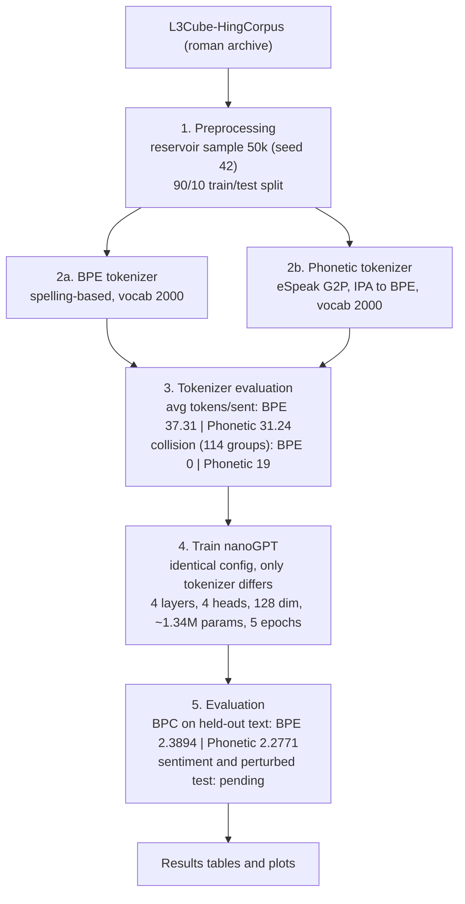

# Sound Over Spelling

Phonetic vs. Subword Tokenization for Hindi/Hinglish Language Modeling

Does turning Hinglish into sounds make a language model more robust to spelling variation than standard subword tokenization?

---

## The Idea

Hinglish has no fixed spelling. The same word is written many ways:

    acha   accha   achha   achcha   ->  "good"
    kuch   kuchh                    ->  "something"

BPE splits text by spelling, so each variant becomes a different token sequence. Phonetic tokenization converts text to eSpeak IPA sounds first, so variants may collapse into the same or similar sequences.

    spelling -> BPE        -> [acha] [accha] [achha]     different sequences
    sound    -> phonetic   -> a t S a / a t S h a        near-identical

---

## Results

| Measure | BPE | Phonetic-BPE | Notes |
|---|---|---|---|
| Vocab size | 2000 | 2000 | Matched target |
| Bits per character (test) | 2.3894 | 2.2771 | Same held-out text. Phonetic predicts sound sequences, so approximate |
| Collision rate (spelling groups) | 0 / 114 | 19 / 114 | On the 50k subset |
| Avg tokens per sentence | 37.31 | 31.24 | 50,000 sentences |

Phonetic-BPE is slightly shorter than BPE on the 50k subset. An earlier 1000-sentence run suggested it was about three times longer; that run was before a bug fix and is superseded.

The BPC gap is small. Treat it as suggestive, not decisive.

---

## Pipeline

---

## Limitations

- **Small scale.** About 1.3M parameters on a 50k-sentence sample.
- **Imperfect G2P.** eSpeak reads some spellings inconsistently (for example, `accha` vs `acha`), so some variants never collapse.
- **Approximate fairness.** The phonetic model predicts sound sequences, so its BPC is only approximately comparable to BPE's.
- **Rare merges.** The phonetic vocabulary starts from about 60 base symbols, so many of its 2000 tokens come from rarer merges.
- **Unverified groups.** Spelling groups include function words and inflections.
- **Missing logs.** Per-batch and per-epoch logs were not saved on the first training run.

---

## Status

- [x] Phonetic tokenizer on eSpeak G2P
- [x] Bits-per-character metric and resumable training
- [x] 50k L3Cube subset
- [x] Training, both tokenizers
- [x] Collision rate and tokens per sentence on the 50k subset
- [ ] Sentiment data and fine-tuning (deferred)
- [ ] Perturbed (spelling-noise) test set (waiting on mentor's instructions)

---

## References

1. Goriely et al. (2024). Babble to Words.
2. Tokenization Limits Phonological Knowledge (2026).
3. L3Cube-HingCorpus, L3Cube Pune.
4. Hinglish-Hindi Transliteration Dataset, Hugging Face.
5. SemEval-2020 Task 9: sentiment analysis of code-mixed tweets.
6. eSpeak NG and Phonemizer.
